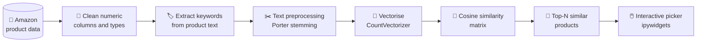
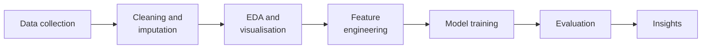

# 🎯 Machine Learning: Zero to Hero

> Applied machine learning case studies, from regression and classification fundamentals to a content-based product recommendation engine built on Amazon data.


## 📌 Overview

This repository covers the complete supervised-learning workflow on real datasets: cleaning data, exploring it, engineering features, training models and evaluating them. The main project is a **product recommendation system** that suggests similar Amazon products using NLP and cosine similarity.

## ⭐ Main project: Amazon Product Recommendation System



**How it works:** each product's name, category and description become a "bag of keywords". After stemming and vectorising, the model measures the cosine similarity between every pair of products. When a user selects a product, the system returns the products with the most similar keyword profiles. The trained model is saved with `pickle` so it can be reused in an app.

## 📒 Case studies

| Notebook | Problem type | Techniques |
|---|---|---|
| `Amazon_Recommendation_System (2).ipynb` | Recommendation | NLP keyword extraction, stemming, CountVectorizer, cosine similarity |
| `Migrants_Analysis.ipynb` | Regression and EDA | Missing-value imputation, automated EDA, Plotly charts, word clouds, Linear Regression |
| `Linear Regression .ipynb` | Regression | Feature scaling, train/test split, Linear Regression and KNN, error metrics |
| `Logistic_Regression.ipynb` | Binary classification | Preprocessing, Logistic Regression, confusion matrix and classification metrics |

## 🔁 Standard ML workflow used



## 🧰 Tech stack

Python · Pandas · NumPy · scikit-learn · NLTK · SciPy · Matplotlib · Seaborn · Plotly · WordCloud · ipywidgets

## ⚙️ Getting started

```bash
git clone https://github.com/SaurabhSharma2388/Machine-Learning-zero-to-Hero.git
cd Machine-Learning-zero-to-Hero
pip install pandas numpy scikit-learn nltk scipy matplotlib seaborn plotly wordcloud ipywidgets jupyter
jupyter notebook
```

## 👤 Author

**Saurabh Sharma** – Senior Data Scientist & Generative AI Engineer
[LinkedIn](https://www.linkedin.com/in/saurabh-sharma-data-scientist/) · [GitHub](https://github.com/SaurabhSharma2388)
